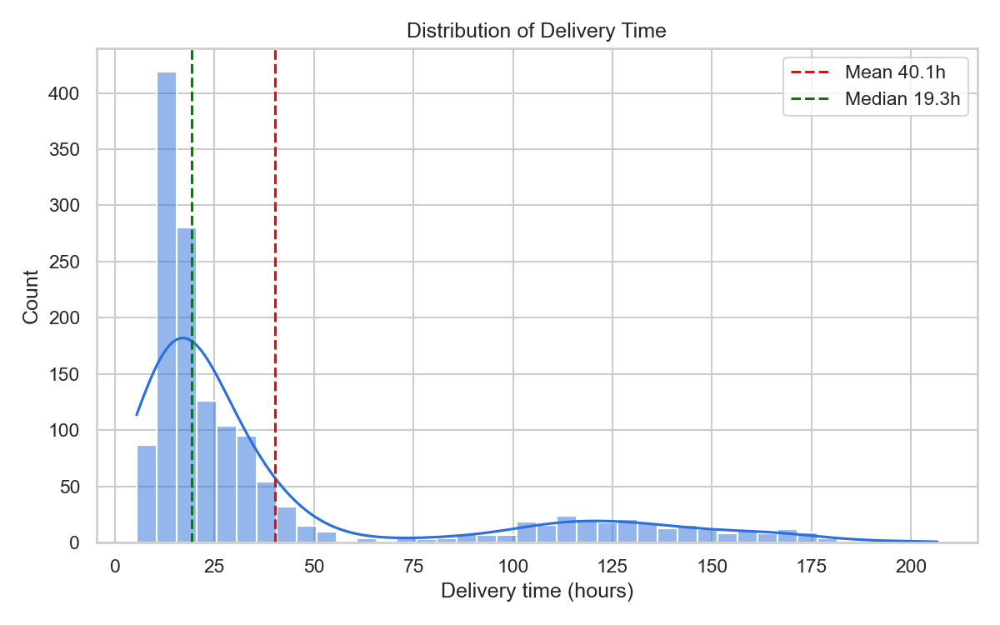
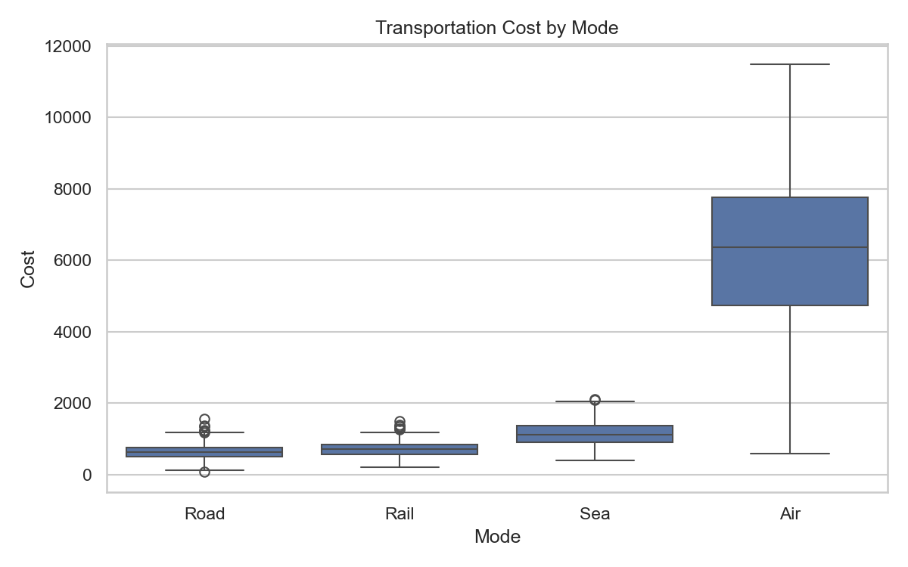
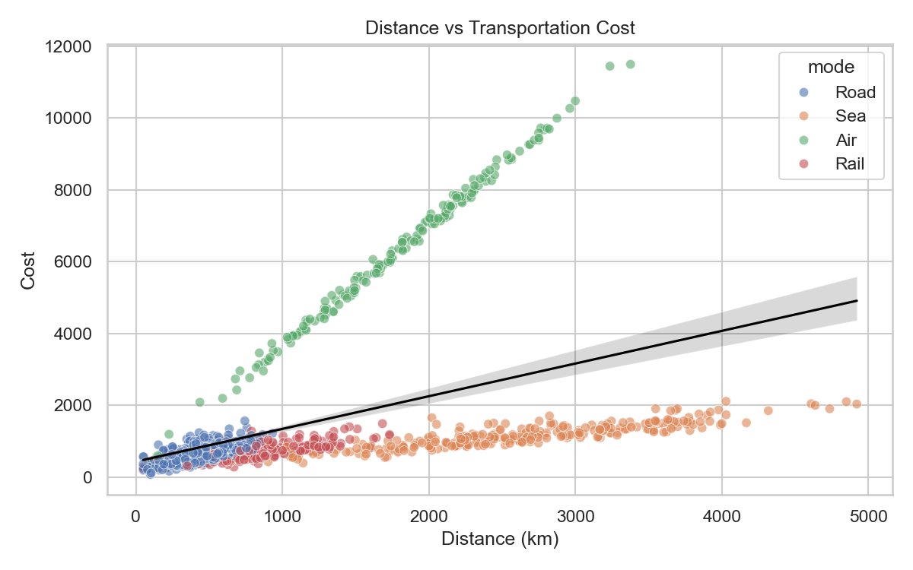
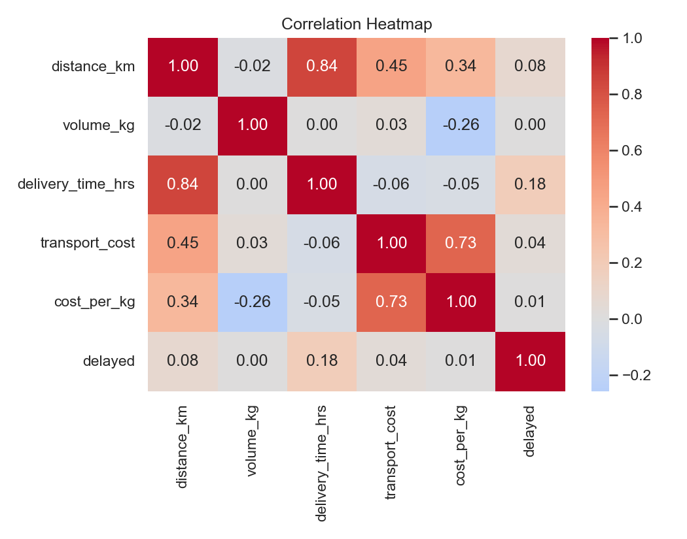
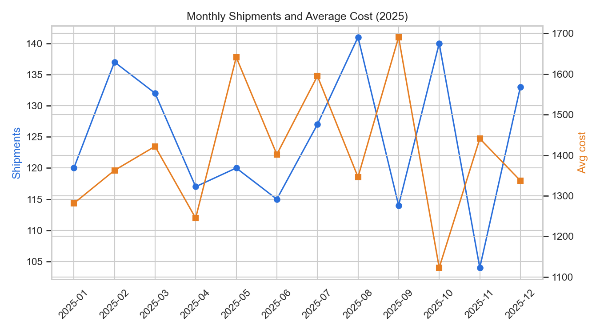
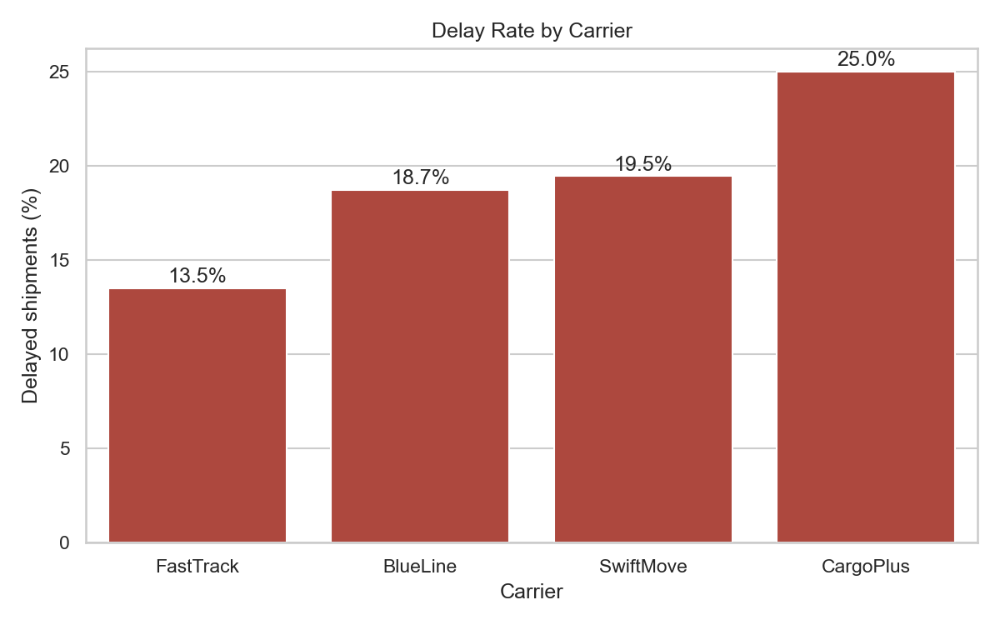
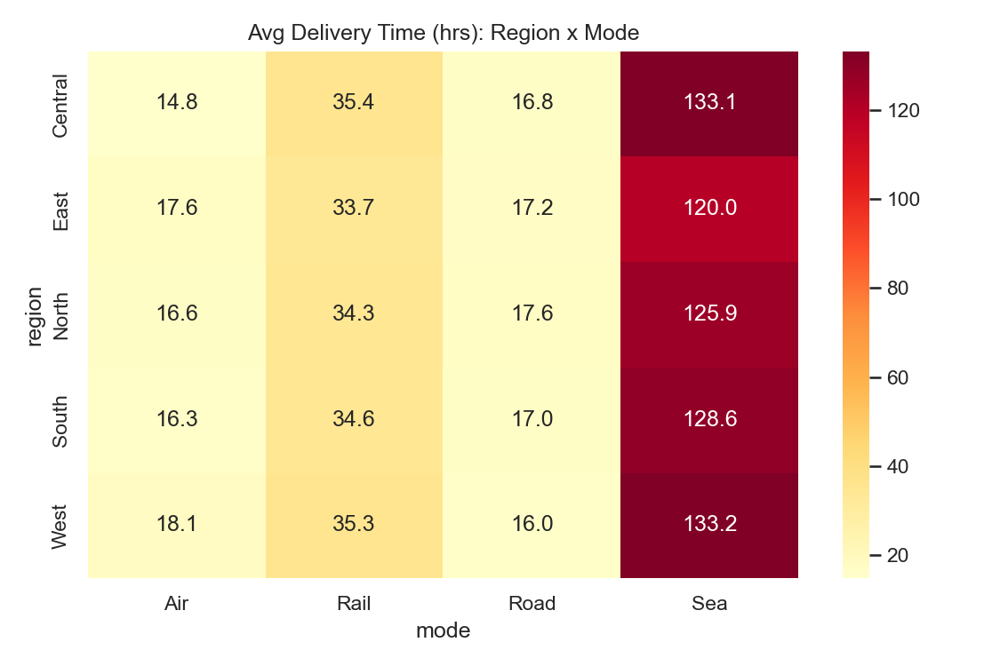

# Advanced Data Analysis and Visualization in Logistics

**Week 3 Task, Yuva Intern Data Analysis Internship**
Exploratory Data Analysis (EDA) and visualization of a hypothetical logistics dataset using Python.

---

## Project Overview

Logistics companies generate large amounts of shipment data every day. This project simulates a logistics dataset of **1,500 shipments (2025)** and uses Python to explore it, visualize it and turn the results into practical business insights about **operational efficiency, cost drivers and bottlenecks**.

## Objectives

- Define a hypothetical logistics dataset (delivery times, shipment volumes, transportation costs)
- Perform EDA: central tendencies, distributions and correlations
- Create multiple visualizations and justify each chart type
- Derive insights and recommendations for logistics decision-making

## Dataset Description

The dataset is generated in code with a fixed random seed (`42`), so results are reproducible. It is saved as `logistics_dataset.csv`.

| Variable | Type | Description |
|---|---|---|
| `shipment_id` | Text | Unique shipment ID |
| `date` | Date | Dispatch date (2025) |
| `region` | Category | North, South, East, West, Central |
| `carrier` | Category | FastTrack, SwiftMove, CargoPlus, BlueLine |
| `mode` | Category | Road, Rail, Air, Sea |
| `distance_km` | Numeric | Distance travelled |
| `volume_kg` | Numeric | Shipment weight |
| `delivery_time_hrs` | Numeric | Total delivery time |
| `transport_cost` | Numeric | Cost per shipment |
| `delayed` | Binary | 1 = delayed, 0 = on time |
| `cost_per_kg` | Derived | `transport_cost / volume_kg` |
| `month` | Derived | Year-month of dispatch |

## Technologies Used

- Python 3
- pandas, NumPy
- Matplotlib, Seaborn

## Project Structure

```
├── logistics_analysis.py      # Main script (simulation, EDA, charts)
├── logistics_dataset.csv      # Generated dataset
├── charts/                    # All saved visualizations
│   ├── fig1_delivery_hist.png
│   ├── fig2_cost_box.png
│   ├── fig3_distance_cost.png
│   ├── fig4_heatmap.png
│   ├── fig5_monthly_trend.png
│   ├── fig6_delay_carrier.png
│   └── fig7_region_mode.png
└── README.md
```

## How to Run

```bash
# 1. Install the libraries
pip install pandas numpy matplotlib seaborn

# 2. Run the script
python logistics_analysis.py
```

The script prints the EDA results in the terminal and saves all 7 charts in the `charts/` folder.

## Methodology

1. **Data simulation:** 1,500 shipments with realistic business logic (Air is fast but costly, Sea is cheap but slow, some carriers are less reliable)
2. **Data cleaning:** 20 missing volume values filled with the median volume of the same transport mode
3. **EDA:** mean, median, standard deviation, skewness, correlation matrix, group-wise aggregation
4. **Visualization:** 7 charts, each chosen to suit the question it answers
5. **Interpretation:** insights and recommendations

## Visualizations

| Chart | Type | Why this chart |
|---|---|---|
| Delivery time distribution | Histogram + KDE | Shows shape and skewness |
| Cost by transport mode | Boxplot | Compares spread and outliers across modes |
| Distance vs cost | Scatter + regression | Shows relationship of two numeric variables |
| Correlation heatmap | Heatmap | Summarizes all relationships at once |
| Monthly shipments and cost | Dual-axis line chart | Shows trend and seasonality |
| Delay rate by carrier | Bar chart | Ranks carriers on reliability |
| Delivery time by region and mode | Pivot heatmap | Compares two categories at once |

### Delivery Time Distribution


### Transportation Cost by Mode


### Distance vs Cost


### Correlation Heatmap


### Monthly Trend


### Delay Rate by Carrier


### Delivery Time by Region and Mode


## Key Findings

- **Distance and delivery time** are strongly correlated (r = 0.84)
- **Mode drives cost:** Air averages about 6,288 per shipment versus about 639 for Road
- **Right-skewed data:** mean delivery time is 40.1 hrs but the median is only 19.3 hrs
- **Overall delay rate** is 19.1%; delayed shipments take about 20 hours longer
- **Carrier reliability:** CargoPlus has a 25% delay rate versus 13.5% for FastTrack
- **Sea freight** is the biggest time bottleneck (about 128 hrs average, 26% delay rate)
- **Economies of scale:** heavier shipments cost less per kg (r = -0.26)

## Recommendations

1. Shift non-urgent Air shipments to Road or Rail where distance allows
2. Move volume from CargoPlus to FastTrack and add SLA penalties
3. Consolidate small loads to lower cost per kg
4. Use Sea freight only for non-urgent bulk cargo and plan inventory buffers
5. Track median and percentile delivery times, not just the mean
6. Monitor transport mode mix monthly when budgeting

## Limitations and Future Work

The data is simulated, so the numbers illustrate the method and do not describe a real company. Future work: a regression model to predict cost, a classification model to predict delays, route optimization, and an interactive Plotly dashboard.

## Author

**Ankit**
B.Tech CSE (AI & ML), Vivekananda Global University, Jaipur
